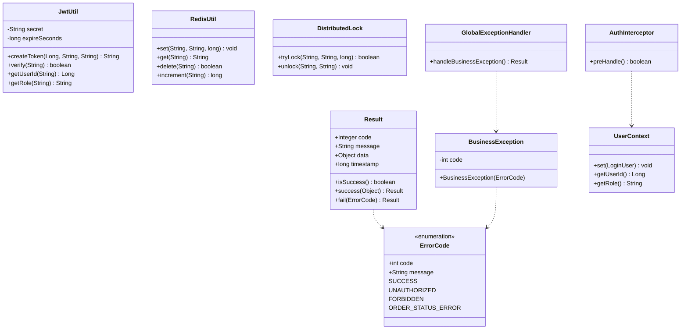
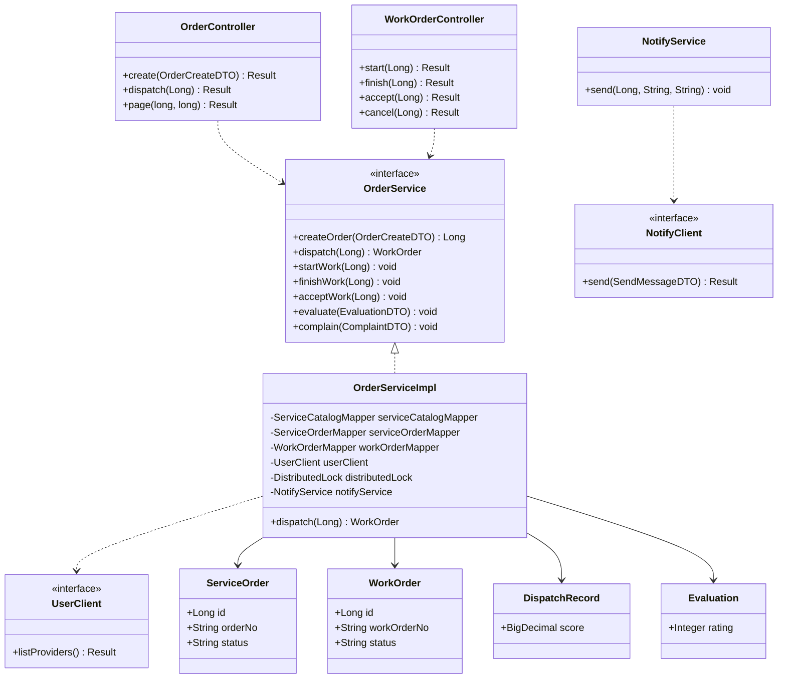
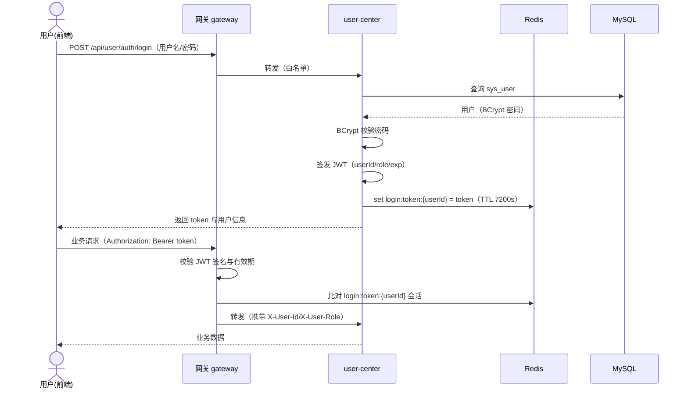
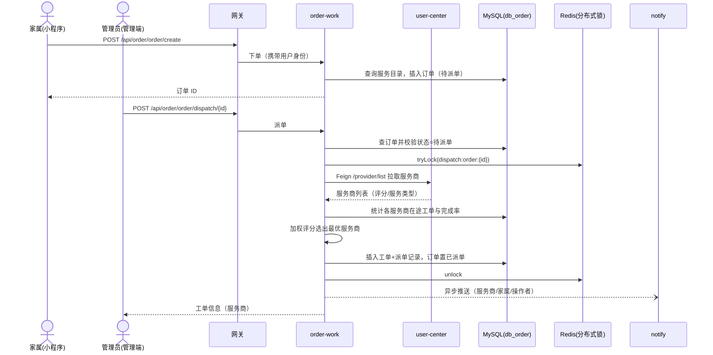
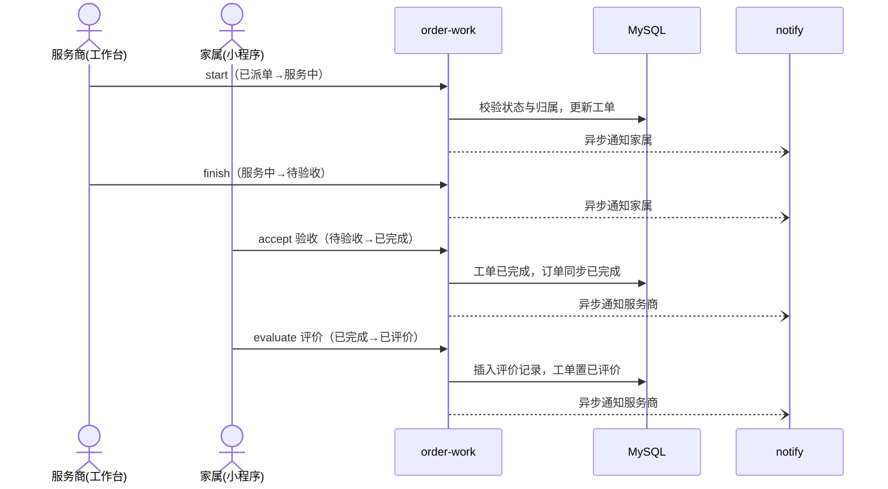

# 社区智慧养老服务系统 详细设计说明书

## 1. 工程结构

```
community-elderly-care/
├── pom.xml                   父工程（版本统一管理）
├── common/                   公共模块
│   ├── common-core           统一返回 Result/PageResult、错误码、业务异常、JWT 载荷常量、跨服务 VO/DTO
│   ├── common-redis          Redis 序列化配置、RedisUtil、分布式锁（SETNX+Lua）
│   ├── common-security       JwtUtil（签发/校验/解析）、LoginUser
│   └── common-web            全局异常处理、XSS 过滤器、鉴权拦截器、@RequireRole、Knife4j 配置
├── gateway/                  网关服务
├── user-center/              用户中心服务
├── order-work/               服务与工单服务
├── health-record/            健康档案服务
├── notify/                   消息通知服务
├── statistics/               统计报表服务
├── sql/                      各库建表与种子脚本
├── infra/                    docker-compose.yml（Nacos/MySQL/Redis）
├── docs/                     设计文档
└── frontend/
    ├── admin-web/            Vue3 管理端
    └── family-miniapp/       微信小程序家属端
```

## 2. 公共模块设计

| 类 | 设计要点 |
|----|----------|
| Result\<T\> | code/message/data/timestamp，isSuccess() 序列化为 success 字段，便于前端判断 |
| ErrorCode | 统一错误码枚举：通用 400~503；1xxx 用户域；2xxx 订单域；3xxx 健康域；4xxx 消息域 |
| BusinessException | 携带 code 的业务异常，由全局异常处理器统一转为 Result |
| AuthConstant | 请求头/Redis 键前缀/角色编码常量 |
| JwtUtil | hutool-jwt 实现；payload 含 userId/role/username/exp；密钥与有效期经配置注入 |
| RedisUtil | String/对象读写、计数、过期，键 String 值 JSON 序列化 |
| DistributedLock | SETNX 加锁（带过期），Lua 脚本按值比对释放，防误删 |
| AuthInterceptor | 读网关透传的 X-User-* 头填充 UserContext（ThreadLocal）；校验 @RequireRole 角色 |
| XssFilter/XssRequestWrapper | 对参数/请求头/JSON 体做 "<"、">" 转义；multipart 透传不处理 |
| GlobalExceptionHandler | BusinessException/参数校验异常/未知异常统一转换 |

## 3. 网关设计（gateway）

### 3.1 路由
5 条路由按 `/api/{service}/**` 前缀匹配，StripPrefix=2 后经 `lb://{service}` 负载均衡转发（Nacos 服务发现 + Spring Cloud LoadBalancer）。

### 3.2 鉴权过滤器 AuthGlobalFilter（GlobalFilter，order=-100）
处理流程：
1. 白名单（登录/注册）直接放行；
2. 提取 `Authorization: Bearer <token>`，校验 JWT 签名与有效期；
3. 解析 userId，比对 Redis 键 `login:token:{userId}` 的值是否等于当前 token（实现登出/改密失效）；
4. 校验通过后向下游请求添加 `X-User-Id / X-User-Role / X-Username` 请求头；
5. 失败返回 `{"code":401,"message":"未登录或令牌无效"}`。

### 3.3 Sentinel 限流
SCA 自动注册 SentinelGatewayFilter；GatewaySentinelConfig 在启动时加载路由级流控规则（user-center 路由 100 QPS）。Sentinel 日志输出到用户目录 logs/csp。

## 4. 用户中心设计（user-center）

- 登录：查 sys_user → BCrypt.checkpw 校验 → JwtUtil 签发（userId/role/username，exp=7200s）→ Redis 写 `login:token:{userId}`（TTL 7200s）→ 返回 LoginVO；
- 注册：用户名唯一校验 → BCrypt.hashpw 存储；
- 登出/改密：删除 Redis 会话键，令牌即刻失效；
- 四角色同表 sys_user（role 区分），角色编码：ADMIN/STAFF/PROVIDER/FAMILY；
- 老人档案 elder 与绑定 family_binding：家属经 `/elder/my` 查询自己绑定的老人；
- 服务商 provider：`/provider/list` 供 order-work 经 OpenFeign 调用（按评分降序）。

核心表 sys_user：id、username（唯一）、password（BCrypt）、phone、role、real_name、avatar、status（1启用/0禁用）、create_time、update_time、deleted（逻辑删除）。

## 5. 服务与工单设计（order-work）

### 5.1 核心表
- service_order：订单（order_no 唯一、family_user_id、service_id、金额、地址、status）；
- work_order：工单（work_order_no 唯一、order_id、provider_id/provider_user_id、status、dispatch/accept/finish 时间）；
- dispatch_record：派单记录（订单/工单/服务商/评分）；
- evaluation：评价（工单、评分 1-5、内容）；
- complaint：投诉（工单、原因、状态 PENDING/HANDLED）。

### 5.2 智能派单算法（dispatch）
```
score = 0.3 * 距离分 + 0.25 * 评分分 + 0.3 * 负载分 + 0.15 * 完成率分
```
- 前置过滤：服务商 service_types 必须包含订单 service_type；
- 距离分：0.8（简化占位，可扩展为地图距离计算）；
- 评分分：服务商评分 / 5（评分经 Feign 从 user-center 获取）；
- 负载分：1 − 在途工单数（已派单/服务中/待验收）/ 最大接单数 10；
- 完成率分：已完成（含已评价）工单数 / 历史总工单数，无历史取 1。

并发控制：`lock:dispatch:order:{id}` 分布式锁（SETNX，10s 过期）包裹整个评分与落库过程；锁外先校验订单状态=待派单，双重防重复派单。

### 5.3 工单状态机
```
DISPATCHED(已派单) → IN_SERVICE(服务中) → WAIT_ACCEPT(待验收) → COMPLETED(已完成) → EVALUATED(已评价)
任意可转：CANCELLED(已取消)；IN_SERVICE/WAIT_ACCEPT 可转：COMPLAINED(已投诉)
```
每个流转方法先做状态前置校验，再做归属校验：
- start/finish：仅该工单服务商（providerUserId==当前用户）；
- accept/evaluate/complain/cancel：仅下单家属或管理员。

### 5.4 消息推送
NotifyService（@Async，专用线程池 notifyExecutor）在状态流转成功后调用 notify 服务 `/message/send`（OpenFeign）；推送失败仅记录日志，不回滚业务。推送场景：派单（通知服务商+家属）、开始/完成服务（通知家属）、验收/评价/投诉/取消（通知服务商）。

## 6. 健康档案设计（health-record）
- health_record：每老人一条，保存时按 elder_id 查询存在则更新否则插入（upsert）；
- health_metric：时序指标，`/trend` 取最近 N 条倒序后反转成升序供图表；
- medication：用药与提醒时间，逻辑删除。

## 7. 消息通知设计（notify）
- `/message/send`（内部接口）：查订阅记录，若用户对该类型已退订则跳过，否则插入 message（read_flag=0）；
- `/message/my`：按当前用户分页倒序；
- `/message/read/{id}`、`/message/unread-count`；
- `/subscribe/toggle`：按 (user_id, msg_type) upsert 订阅状态。

## 8. 统计报表设计（statistics）
- order-work 提供 `/stat/summary|trend|service-rank` 数据源接口（mapper 聚合，小数据量在 Java 内存聚合）；
- statistics 经 OpenFeign 调用并按 key 写入 Redis 缓存（30 秒），对外提供 `/report/**`；
- statistics 无独立数据库，体现数据隔离与聚合模式。

## 9. 前端设计

### 9.1 管理端（Vue3 + Element Plus）
- 基础设施：axios 拦截器（自动带 token、code≠200 统一提示、401 跳登录）、路由守卫、Element Plus 中文环境；
- 页面：登录、数据看板（统计卡片 + ECharts 折线/柱状图）、用户管理、服务管理、订单管理（智能派单）、工单管理（取消）、健康档案（老人切换 + 档案/指标/用药）、消息中心（点击已读）；
- 开发期 Vite 代理 `/api → localhost:8080`；生产 `vite build` 后由 Nginx 托管。

### 9.2 家属端小程序（原生）
- request 封装：自动携带 token、401 跳登录、错误 toast；
- 页面：登录、首页（服务列表+下单弹窗）、订单（我的工单）、工单详情（按状态显示验收/评价/投诉/取消）、健康（老人切换+档案+指标录入+用药）、消息（点击已读）；
- 配置：`utils/config.js` 中 baseUrl 指向网关（真机预览改为局域网 IP）。

## 10. UML 类图与时序图

### 10.1 公共模块核心类图



### 10.2 订单与工单模块核心类图



### 10.3 登录与鉴权时序图



### 10.4 下单与智能派单时序图



### 10.5 工单流转与评价时序图


